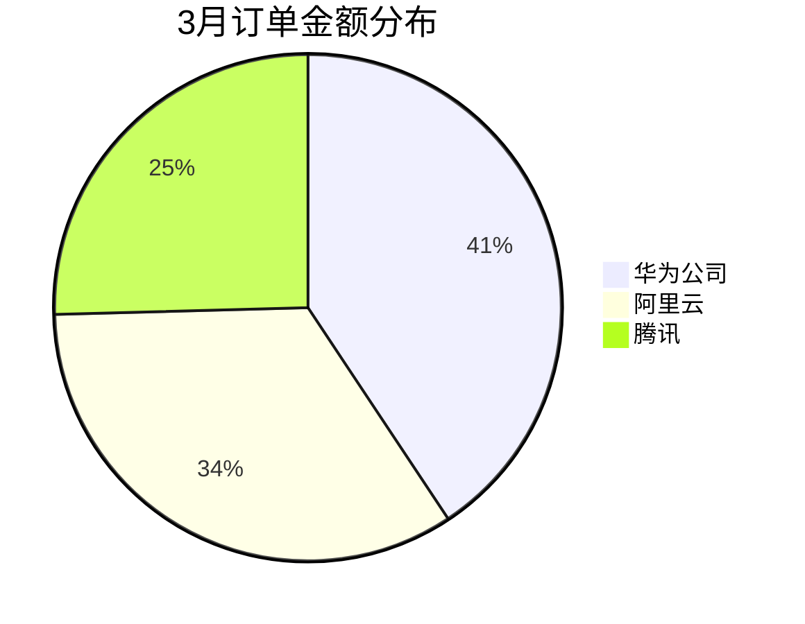

# 数据分析模块设计文档

> 版本：2026-08-25 | 状态：待实施

## 1. 背景与目标

**用户场景**：客户上传结构化表格（CSV/XLS/XLSX）→ 系统自动解析入库业务瀚高数据库 → 在对话框中用自然语言提问 → 大模型转换为 SQL 查询 → 返回自然语言回答（含图表）。

**核心能力**：
- 建表向导：用户指定表名（默认 tb_ 前缀）、列名/类型/说明，系统在瀚高中建表
- 异步数据导入：上传文件 → 后台解析 → 批量入库，支持脏数据跳过+错误报告
- 自然语言查询：智能体通过工具链（list → describe → query）将客户问题转为 SQL 执行并回答
- 图表渲染：Mermaid 图表在对话框内直接渲染（第一期），AntV 交互式图表（第二期）

**不在本期范围**：
- 修改表结构（加列/改类型）、删表（清空重导入可行）、连接客户已有库查询
- 超大文件流式导入（>500MB）、写入类操作（INSERT/UPDATE/DELETE 由智能体执行）

## 2. 架构总览

```
┌─ 前端「数据分析」菜单 ──────────────────────────┐
│  表列表（分页/模糊查询）/ 建表向导 / 数据导入 / 任务列表  │
│  + 对话框 Mermaid 图表渲染                          │
└──────────────────┬───────────────────────┘
                   │ REST API
┌──────────────────▼───────────────────────┐
│  主应用新增 data_tables 模块               │
│  ├─ 表元数据管理（存系统 PG17）             │
│  ├─ 异步导入 Worker（解析 → 清洗 → 批量入库）  │
│  └─ Agent 工具：list / describe / query   │
└──────────────────┬───────────────────────┘
                   │ psycopg2（镜像已预装）
        ┌──────────▼──────────┐
        │   业务瀚高库（安全版 v4.5）│
        │  ├─ 库: admin          │
        │  ├─ 库: zhaowy ← 按系统登录账号建库隔离 │
        │  └─ 库: test           │
        └─────────────────────┘
```

**关键决策**：
- 系统 PG17 只存元数据（表注册、列说明、导入任务），业务数据全部落瀚高
- 按系统登录账号在瀚高中建立独立数据库，同库下不同用户数据完全隔离
- 驱动已预装：oracledb 4.0.1 / psycopg2-binary 2.9.12 / PyMySQL 1.2.0 / SQLAlchemy 2.0.51

## 3. 数据源与隔离

### 3.1 瀚高连接配置（管理端设置页）

在管理端「数据源配置」页面填写：
- Host / Port / 用户名 / 密码（密码复用现有 `encrypt_dict_fields` 加密存储）
- 该账号需具备 CREATEDB 权限

配置存储在系统 PG17 的 `data_source_config` 表中，密码字段加密。连接串存入环境变量 `QWENPAW_DATA_SOURCE_URL` 供后台使用。

### 3.2 按用户建库隔离

- 用户首次建表或导入时，自动执行 `CREATE DATABASE "<slug(username)>"`
- 库名做 slugify 处理：仅保留小写字母/数字/下划线，长度 ≤ 63 字符
- 数据库已存在则跳过创建
- 普通用户只能看到和操作自己库中的表
- 管理员可查看和查询所有用户库（通过切换连接参数）

## 4. 数据模型（系统 PG17）

### 4.1 数据源配置表

```sql
CREATE TABLE data_source_config (
    id UUID PRIMARY KEY DEFAULT gen_random_uuid(),
    name TEXT UNIQUE NOT NULL,        -- 如 'highgo_default'
    host TEXT NOT NULL,
    port INTEGER NOT NULL DEFAULT 5432,
    username TEXT NOT NULL,            -- 瀚高 SUPERUSER/CREATEDB 账号
    password_encrypted TEXT NOT NULL,  -- 加密存储
    created_at TIMESTAMPTZ DEFAULT now(),
    updated_at TIMESTAMPTZ DEFAULT now()
);
```

### 4.2 表注册表

```sql
CREATE TABLE data_table_registry (
    id UUID PRIMARY KEY DEFAULT gen_random_uuid(),
    owner_username TEXT NOT NULL,
    db_name TEXT NOT NULL,             -- 目标瀚高库名
    table_name TEXT NOT NULL,          -- 实际表名（含前缀）
    description TEXT DEFAULT '',       -- 表描述（参与模糊查询）
    columns JSONB NOT NULL,            -- [{name, type, comment, nullable, is_primary_key}]
    row_count BIGINT DEFAULT 0,        -- 导入后更新
    created_at TIMESTAMPTZ DEFAULT now(),
    updated_at TIMESTAMPTZ DEFAULT now(),
    UNIQUE(owner_username, table_name)
);
```

列定义 JSONB 示例：
```json
[
  {"name":"order_id","type":"BIGINT","comment":"订单ID","nullable":false,"is_primary_key":true},
  {"name":"customer_name","type":"TEXT","comment":"客户名称","nullable":false,"is_primary_key":false},
  {"name":"order_amount","type":"NUMERIC(12,2)","comment":"订单金额（元）","nullable":true,"is_primary_key":false},
  {"name":"order_date","type":"DATE","comment":"下单日期","nullable":false,"is_primary_key":false},
  {"name":"status","type":"INTEGER","comment":"订单状态：1待付款 2已付款 3已发货 4已完成","nullable":false,"is_primary_key":false}
]
```

### 4.3 导入任务表

```sql
CREATE TABLE data_import_job (
    id UUID PRIMARY KEY DEFAULT gen_random_uuid(),
    table_id UUID NOT NULL REFERENCES data_table_registry(id) ON DELETE CASCADE,
    filename TEXT NOT NULL,
    status TEXT NOT NULL DEFAULT 'pending',  -- pending/parsing/loading/completed/partial/failed
    total_rows BIGINT DEFAULT 0,
    success_rows BIGINT DEFAULT 0,
    failed_rows BIGINT DEFAULT 0,
    errors JSONB DEFAULT '[]',               -- [{row, column, message}] 最多100条
    file_path TEXT,                          -- 上传文件路径（任务完成后清理）
    created_at TIMESTAMPTZ DEFAULT now(),
    finished_at TIMESTAMPTZ
);
```

## 5. 表格数据类型映射

用户建表时选择的类型 → 瀚高 PG 列类型映射：

| 用户选择 | 瀚高列类型 | Python 清洗 |
|---------|-----------|------------|
| 文本 | `TEXT` | str 或空值 |
| 整数 | `INTEGER` | int，失败设 NULL |
| 长整数 | `BIGINT` | int，失败设 NULL |
| 小数 | `NUMERIC(12,2)` | Decimal，失败设 NULL |
| 日期 | `DATE` | date，支持多种格式自动解析 |
| 时间戳 | `TIMESTAMP` | datetime，支持多种格式自动解析 |
| 布尔 | `BOOLEAN` | true/false/1/0/是/否 |

日期格式自动尝试：`YYYY-MM-DD` / `YYYY/MM/DD` / `YYYYMMDD` / `DD/MM/YYYY` / `MM/DD/YYYY` / 中文 `YYYY年MM月DD日`。

## 6. 异步导入流程

```
上传文件(csv/xls/xlsx)
  → 存入 /app/working/data_uploads/<task_id>/<filename>
  → 创建 data_import_job（status=pending）
  → 返回任务ID（前端轮询进度）

后台 Worker 异步：
  status = parsing
  ├─ CSV：自动检测编码（charset-normalizer chardet），尝试 UTF-8/GBK/GB2312/GB18030
  ├─ Excel：openpyxl/xlrd 读取
  ├─ 按列定义进行类型清洗和转换
  └─ 错误行记录（最多 100 条）

  status = loading
  ├─ 批量写入瀚高：execute_batch，每批 1000 行
  ├─ 事务：整个批次一个事务，单批失败整体回滚重试
  └─ 错误行跳过并记录

  status = completed / partial / failed
  ├─ 更新 data_table_registry.row_count
  └─ 清理上传文件
```

**编码处理优先级**：UTF-8 → UTF-8-BOM → GBK → GB2312 → GB18030。检测置信度 < 0.9 时尝试多种编码，取解析成功率最高的。

**追加导入**：同一表多次上传，数据追加（不覆盖）。如需全量重导，先清空再导入。

## 7. 建表向导

页面流程：

1. **表名**：文本输入，默认补 `tb_` 前缀，校验正则 `^tb_[a-z][a-z0-9_]{0,62}$`，唯一性校验（同用户下不可重复）
2. **表描述**：文本输入，参与模糊查询
3. **列定义**（可增删）：
   - 列名：校验 `^[a-z][a-z0-9_]{0,62}$`，同表唯一
   - 类型：下拉选择（文本/整数/长整数/小数/日期/时间戳/布尔）
   - 列说明：必填，业务含义描述
   - 是否可空：复选框，默认可空
   - 是否主键：复选框，最多一个
4. **自动推断**（可选）：上传样例文件 → pandas 读取 → 推断列名和类型 → 填充列定义表单 → 用户可手动修改
5. **确认创建**：后端校验 → 在瀚高执行 `CREATE TABLE` + `COMMENT ON COLUMN` → 写入系统 PG17 元数据

## 8. Agent 查询工具

### 8.1 工具注册

三个工具（与 knowledge 工具同模式，注册在 `agents/tools/` 目录）：

#### `list_data_tables`
- 输入：无
- 返回：当前用户库中所有表的名称、描述、列数、行数
- 用途：智能体了解有哪些数据可查

#### `describe_data_table(table_name: str)`
- 输入：表名
- 返回：建表语句（DDL）+ 每列的列说明 + 行数 + 3 行样例数据
- 用途：智能体理解表结构和业务含义，据此生成 SQL

#### `query_data_table(sql: str)`
- 输入：SQL 语句
- 返回：查询结果（列名 + 行数据，最多 100 行）
- 安全校验（工具层强制）：
  - 只允许 SELECT / WITH 开头
  - 黑名单：INSERT / UPDATE / DELETE / DROP / ALTER / TRUNCATE / CREATE / GRANT / REVOKE
  - 注释绕过检测：去除 `/* */` 和 `--` 行注释后再校验
  - SQL 无 LIMIT 时自动加 `LIMIT 100`
  - 语句超时：30 秒
  - 只连当前登录用户自己的瀚高库

### 8.2 智能体对话流程

```
客户："帮我看看3月份订单金额最高的前5个客户"
  ↓
智能体：调 list_data_tables() → 发现 tb_order（订单数据）
  ↓
智能体：调 describe_data_table("tb_order") → 获得列说明
  ↓
智能体：生成 SQL → 调 query_data_table(sql)
  ↓
智能体：解读结果，用自然语言回答（含 Mermaid 图表）
```

**多轮工具调用**：智能体可在一次回复中多次调用工具，支持对比分析、聚合统计等复杂场景。

**SQL 自动重试**：工具返回错误时，智能体可修正 SQL 并重试（最多 3 次），客户无感知。

### 8.3 Schema 自动注入

类似 `knowledge_auto_context` 机制，在对话开始时自动注入当前用户的数据表列表（表名+描述），减少一次 list_data_tables 工具调用。注入到上下文后由前端过滤（复用已有的 `INTERNAL_INJECTION_NAMES` 过滤机制），客户不可见。

## 9. 图表渲染

### 9.1 第一期：Mermaid（零成本）

智能体在回答文本中嵌入 mermaid 代码块：

````markdown

````

- 前端已有 `MermaidCodeBlock` 组件，自动渲染
- 支持：pie（饼图）、xychart-beta（柱状图/折线图）、flowchart（流程图）、mindmap
- 客户直接在对话中看到渲染后的图表

### 9.2 第二期：AntV 交互式图表

- 已安装 `@ant-design/plots ^2.6`（AntV）
- SDK 有 `DATA` 内容类型但前端未处理（当前 fallback 到 JSON.stringify）
- 实施：在 `HostMessage` 中新增 `DATA` 类型渲染器 → 根据 `data.chartType` 动态渲染 AntV 图表
- 优势：交互式（tooltip、缩放、筛选）、多图表类型

## 10. 前端页面

### 10.1 「数据分析」菜单

新增菜单项 `core.data-analysis`，与 core.inbox 同级。

路由：`/data-analysis`

### 10.2 数据表列表页

```
┌──────────────────────────────────────────────────────────┐
│ [搜索: 名称/描述________] [创建时间 ____~____] [查询] [重置] │
│                                              [+ 新建数据表] │
├──────────────────────────────────────────────────────────┤
│ 表名       | 描述      | 列数 | 行数   | 创建时间 | 修改时间 | 操作         │
│ tb_order   | 订单数据   | 12  | 8.2万  | ...    | ...    | [录入][预览][删除] │
│ tb_user    | 用户信息   | 8   | 1200  | ...    | ...    | [录入][预览][删除] │
│ tb_product | 产品目录   | 6   | 350   | ...    | ...    | [录入][预览][删除] │
├──────────────────────────────────────────────────────────┤
│                    < 1  2  3  ... >  每页 20 条            │
└──────────────────────────────────────────────────────────┘
```

- 模糊查询：名称+描述联合模糊匹配，创建/修改时间范围筛选
- 分页：服务端分页，每页默认 20 条，支持切换 10/20/50
- 行数显示：导入完成后更新，不做实时 count（大表性能问题）
- 操作：
  - **录入** → 弹窗上传数据文件（可多文件），走异步导入
  - **预览** → 抽屉展示 Schema 视图 + 前 100 行数据 + 导入历史
  - **删除** → 二次确认（提示将 DROP TABLE 删除瀚高中真实表及全部数据）

### 10.3 建表向导

- 表名输入（默认 tb_ 前缀）+ 唯一性校验
- 表描述输入
- 列定义表格（可增删行）：列名 / 类型（下拉）/ 列说明（必填）/ 可空（复选）/ 主键（复选）
- "上传样例推断"按钮：上传文件后自动填充列定义，用户可修改
- 确认创建 → 后端校验 + 建表

### 10.4 数据导入

- 选择目标表 → 上传文件（支持 CSV/XLS/XLSX，**支持多文件同时上传**，单文件 ≤ 100MB）
- 上传后每个文件创建独立的异步导入任务，进入任务列表
- 任务列表：任务ID / 文件名 / 状态 / 总行数 / 成功 / 失败 / 创建时间 / 操作
- 失败任务可查看错误明细（行号+列+原因，最多 100 条）

### 10.5 对话框图表

- 对话框中嵌入的 Mermaid 代码块自动渲染为图表
- 无需新增组件，复用现有 `RenderableCodeBlock` → `MermaidCodeBlock` 管线

## 11. API 设计

### 11.1 数据源配置（管理端）

| 方法 | 路径 | 说明 |
|------|------|------|
| GET | /api/data-source | 获取当前数据源配置（密码脱敏） |
| PUT | /api/data-source | 更新数据源配置 |
| POST | /api/data-source/test | 测试连接 |

### 11.2 表管理

| 方法 | 路径 | 说明 |
|------|------|------|
| GET | /api/data-tables?page=1&page_size=20&keyword=&created_start=&created_end= | 分页列表（模糊查询） |
| POST | /api/data-tables | 创建数据表 |
| GET | /api/data-tables/{id} | 表详情（schema+行数+样例） |
| DELETE | /api/data-tables/{id} | 删除表（DROP TABLE） |
| POST | /api/data-tables/{id}/clear | 清空表数据（TRUNCATE） |

### 11.3 数据导入

| 方法 | 路径 | 说明 |
|------|------|------|
| POST | /api/data-tables/{id}/import | 上传文件创建导入任务（支持多文件） |
| GET | /api/data-import-jobs?table_id=&page=1&page_size=10 | 导入任务列表 |
| GET | /api/data-import-jobs/{id} | 任务详情（含错误明细） |
| DELETE | /api/data-import-jobs/{id} | 删除任务记录 |

### 11.4 数据预览

| 方法 | 路径 | 说明 |
|------|------|------|
| GET | /api/data-tables/{id}/preview?limit=100 | 预览前 N 行 |

## 12. 安全机制

### 12.1 SQL 注入防护

- 工具层强制只读校验（白名单：SELECT / WITH）
- 注释绕过检测：执行前去除 `/* */` 块注释和 `--` 行注释
- 参数化查询：表名白名单校验（只允许用户拥有的表名），表名参数化拼接
- 禁止多语句执行（分号分隔多个 SQL）

### 12.2 资源保护

- 查询超时：30 秒
- 结果行数上限：100 行
- 文件上传大小：单文件 100MB，多文件累计 500MB
- 导入并发：每个用户最多 3 个并发导入任务
- 多文件上传：支持选择多个文件一次性上传，每个文件独立创建异步导入任务

### 12.3 访问控制

- 普通用户：只操作自己的库（owner_username == current_user）
- 管理员：可操作所有用户库
- 删除操作需二次确认 + 权限校验

## 13. 依赖清单

现有依赖已满足需求，无需新增 Python 包：
- psycopg2-binary 2.9.12（瀚高连接 + 批量写入）
- SQLAlchemy 2.0.51（连接管理）
- pandas + openpyxl（Excel 解析，已有）
- charset-normalizer（CSV 编码检测，已有）

前端依赖已满足：
- @ant-design/plots ^2.6.8（第二期 AntV 图表）
- mermaid ^11.12.2（第一期 Mermaid 图表）

## 14. 实施分期

### 第一期（核心功能）
- 数据源配置管理
- 建表向导 + 列定义
- 异步数据导入 + 错误报告
- Agent 查询工具（list/describe/query）
- 对话框 Mermaid 图表渲染
- 数据表列表（分页/模糊查询/删除）

### 第二期（增强）
- 样例文件自动推断列类型
- AntV 交互式图表（DATA 内容类型渲染器）
- 连接客户已有库查询（只读，额外数据源配置）
- 查询结果导出（CSV/Excel）
- 常用问题收藏
- 图表保存为图片

## 15. 风险与注意事项

| 风险 | 缓解 |
|------|------|
| 瀚高 CREATEDB 权限不足 | 部署文档明确要求；连接测试接口验证权限 |
| 大文件导入超时 | 异步任务 + 进度轮询；超大文件拆分提示 |
| SQL 注入绕过 | 白名单 + 注释清除 + 参数化；定期安全审计 |
| 多用户并发写同一瀚高库 | psycopg2 连接池隔离 + 事务隔离 |
| 瀚高 v4.5 PG 内核兼容性 | 已验证 psycopg2 直连可行；复杂 SQL 以标准 PG 语法为准 |
